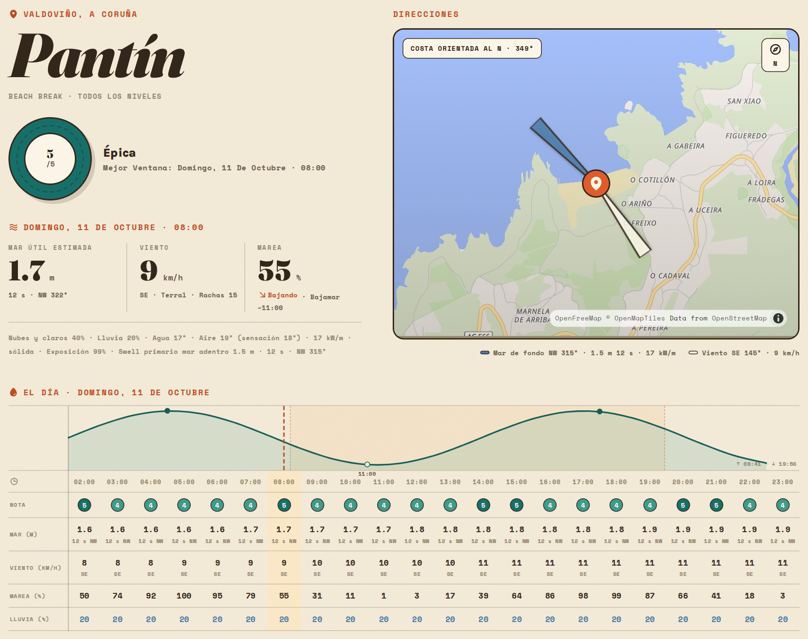

# Surfay

An experimental surf forecast for the Galician coast. Surfay combines
Open-Meteo forecasts with spot-specific coastal exposure, a limited SWAN
bathymetric transfer table, and an explainable 0–5 quality score.

**Status:** working prototype, not a validated surf forecasting service.
The confidence indicator is a heuristic about input/profile completeness;
it is not a measured probability that the forecast is correct. Check actual
conditions before planning a session.

[Engineering decisions](docs/engineering.md) · [Measured local performance](docs/performance.md) · [Run locally](#start-locally)

The view below is captured from the built application with synthetic weather
fixtures and live OpenFreeMap cartography. It demonstrates the UI, not actual
conditions or forecast accuracy. Map attribution is retained in the image.



## What is implemented

- Spanish/Galician map and spot-detail views with hourly forecasts.
- Server-side scoring and per-spot compressed D1 snapshots.
- Thirty-minute refreshes, distributed refresh leases and up to eight hours
  of stale fallback when compatible data exists.
- Better Auth accounts and server-enforced user/reporter/admin roles.
- Draft, publish and archive workflows with transactional catalogue checks.
- Moderated condition reports that retain the selected forecast-hour evidence.
- Unit tests and local D1 integration tests for permissions, concurrent
  publication, rollback, refresh limits and report integrity.
- Browser smoke checks for map navigation, hour selection, reporter login,
  report persistence and the account view, using the production bundle.

The score model still needs observation-based calibration. Email verification,
password-recovery delivery, billing and advertisements are not implemented.
Do not treat the membership schema as a working payment product.

## Architecture

React/MapLibre static assets and `/api/*` share one Cloudflare Worker origin.
The Worker reads its published spot catalogue from D1, calls Open-Meteo,
scores the forecast and stores one compressed snapshot per spot. A publication
batch changes the spot, catalogue version and candidate snapshots together.
A database trigger rejects stale revision/version preconditions before writes.

Permissions are separate from membership plans. Reporter/admin access is
required for condition reports; catalogue changes and moderation require an
administrator. The last-active-admin invariant is enforced by a D1 trigger,
including Better Auth's direct role and ban writes.

Forecast hours are UTC instants; the UI consistently displays Galicia's
`Europe/Madrid` timezone, including when viewed from another country.

## Start locally

Install **Bun 1.4.3** and a current Node.js runtime (CI uses Node 24).
Python 3 is needed for the publication scan and optional model tooling.

```bash
bun install --frozen-lockfile
bun run setup:local
bun run dev -- --host 127.0.0.1
```

Open `http://127.0.0.1:5173`. Setup creates a private `.dev.vars` with a random
local auth secret and applies local D1 migrations. It preserves an existing
`.dev.vars`. See `.dev.vars.example` for variable names. No Cloudflare account
or production secret is needed for local development or tests.

Create an account in the local UI, then promote it if you want to inspect admin:

```bash
bun run admin:promote -- --email admin@example.com --local
```

The default forecast requires Open-Meteo network access. Full-resolution
shoreline geometry for the admin exposure calculator is an optional external
dataset; it is not bundled. Seeded forecasts use the checked-in profiles.
See [model-data setup](docs/model-data.md) before using that calculator.
The full source-dataset regression remains **unverified**. Synthetic geometry
tests pass, but do not establish that the optional coastline workflow has been
fully reproduced from the external source.

## Verification

```bash
bun run check                 # lint, portable unit/D1 tests, production build
bun run security:scan         # tracked source + all fetched Git history
bun run test:data             # optional real shoreline dataset regression
bunx playwright install chromium
bun run test:e2e              # run after build; real UI/Worker/D1, fixture weather
bun run benchmark 20          # run after build; local uncached/cached API timings
```

`test:data` requires generated shoreline tiles. It is separate from the
portable geometry unit tests and fails if its required dataset is missing.
CI runs a frozen dependency install, sanitation scan, lint, tests and build,
plus a timezone test under a non-European timezone and the browser flows.
Browser failures retain traces; CI uploads the browser report and a local
benchmark JSON. See [engineering decisions](docs/engineering.md) for coverage
and [performance notes](docs/performance.md) for measurement limits.

To recapture the README screenshot after building (requires OpenFreeMap access):

```bash
bun run capture:readme
```

`test:e2e` starts its own isolated server on port 4173 and does not reuse your
development database or `.dev.vars`. A preinstalled compatible Chromium can be
selected with `SURFAY_CHROMIUM_EXECUTABLE=/absolute/path/to/chromium`.
The screenshot command uses the same isolated fixture Worker with live map
tiles. The browser tests continue to use a blank local style for offline checks.

## Deploy your own instance

The checked-in Wrangler config contains a placeholder database ID. Keep your
real deployment configuration in the ignored `wrangler.production.json`.

1. Authenticate and create a database:

   ```bash
   bunx wrangler login
   bunx wrangler d1 create surfay
   ```

2. Copy `wrangler.jsonc` to `wrangler.production.json` and replace its
   `database_id` with your new D1 ID. Set your own Worker name/domain as needed.

3. Set secrets on that instance:

   ```bash
   bunx wrangler secret put BETTER_AUTH_SECRET --config wrangler.production.json
   bunx wrangler secret put BETTER_AUTH_URL --config wrangler.production.json
   bunx wrangler secret put TRUSTED_ORIGINS --config wrangler.production.json
   ```

   Generate a new production secret with at least 32 random bytes.
   `BETTER_AUTH_URL` is the final HTTPS origin; `TRUSTED_ORIGINS` is an explicit
   comma-separated origin allow-list. Never reuse local values.

4. Run `bun run check`, then:

   ```bash
   bun run db:migrate:remote
   bun run deploy
   ```

5. Create the first account on the deployed app. Only then run:

   ```bash
   bun run admin:promote -- --email admin@example.com --remote
   ```

Migration 0009 adds publication guards, forecast provenance on reports and the
refresh lease. Deploy it before the updated Worker. Model v8 invalidates old
naive-time snapshots; the first request/cron creates UTC-compatible forecasts.

See [public release and live verification](docs/public-release.md) for a
history-free export and the production checks. The deployed instance has not
been verified in this workspace; local fixture tests do not establish its state.

## Project layout

| Path | Purpose |
| --- | --- |
| `src/domain/` | Scoring, geography, time handling and validation |
| `src/features/`, `src/pages/` | UI and feature components |
| `worker/` | Auth, catalogue, forecast, reporting and admin APIs |
| `migrations/` | Versioned D1 schema and catalogue upgrades |
| `scripts/` | Local setup, admin bootstrap, model generators and sanitation |
| `test/` | Isolated D1 test database harness |

Read [rating-model.md](docs/rating-model.md) for the assumptions, limitations
and calibration workflow, and [THIRD_PARTY_NOTICES.md](THIRD_PARTY_NOTICES.md)
for data attribution. Original application code is [MIT licensed](LICENSE).
